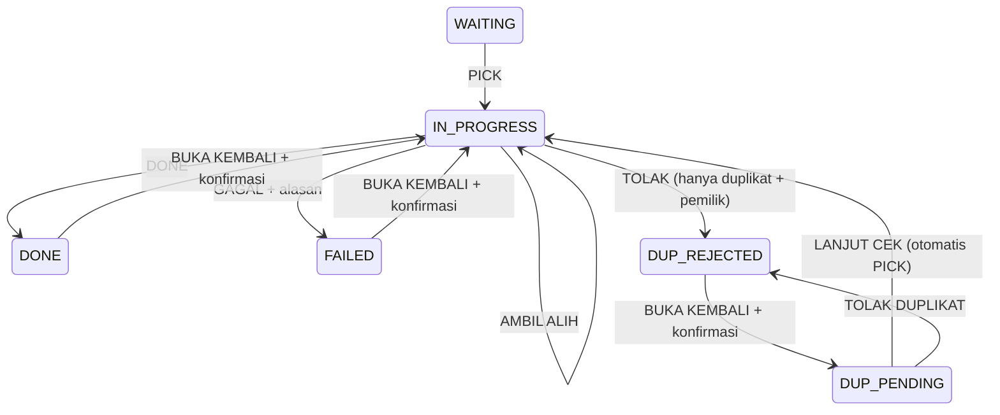

# Batch 11 — HD Operational Workflow dan Dashboard Rekap

Acuan `cb10f0e636b146386f61bbb4544cff03ba32ae26`, branch `chore/remove-cacti-hdwork2`. Implementasi development, **belum diaktifkan pada server/database aktif**. Tidak ada bot produksi, deploy, perubahan Cloudflare/domain atau impor hd_b2c/Sheets/Telethon. Preview DEMO tetap terpisah, desain global/CSS tidak diubah.

## Audit dan keputusan kompatibilitas

Batch 4–10 sudah menyediakan status WAITING/IN_PROGRESS/DONE/FAILED/DUPLICATE, canonical duplicate, inbox/outbox, audit, command fields serta cookie JWT/session/RBAC. Yang belum ada: ownership akun web, optimistic version, audit web yang tidak berasal dari inbox, statistik, live invalidation dan writer XLSX. Semua digunakan kembali; tidak ada tabel order baru atau sistem login baru.

Status DUPLICATE tetap asli dengan duplicate_decision nullable/CONTINUE_CHECK/REJECT_DUPLICATE. Tidak menambah enum status atau menjadikan PICK sebuah status. Aktor web memakai user_id FK, tidak menggunakan last_actor_id/actor_id Telegram sebagai ID akun web. Snapshot nama aktor/pemegang sebelumnya tersimpan dalam audit. Nama akun terkini tetap dipakai pada daftar pemegang.

Riwayat scope hanya empat command bot baru di hdwork2 dengan telegram_timestamp tersedia; baris legacy/tanggal impor tidak dipaksakan menjadi pekerjaan baru. Parser dan aturan canonical lintas grup/tanggal tidak berubah. Jika flag workflow aktif, reply status Telegram lama tidak boleh melewati ownership web: disimpan sebagai audit ignored, integrasi status lewat bot ditunda ke Batch12. Command masuk tetap melalui adapter yang sama dan menulis invalidation secara transaksional.

## Pengelompokan visual dan izin

| Area visual | Command | Modul izin backend |
|---|---|---|
| TIAL | /order | TIAL |
| TIAL | /req | REQ |
| LOGIC / SOLVER | /config_psb | LOGIC_PSB |
| LOGIC / SOLVER | /MO | LOGIC_MO |

Modul bukan sekadar navigasi: SELECT list/detail/history/rekap/export memfilter access_module. Role SUPER_ADMIN/ADMIN/SHOW_ONLY membaca sesuai RBAC Batch10; SUPER_ADMIN punya semua modul. **Hanya HD aktif** boleh melakukan tindakan kerja, termasuk takeover/reopen. ADMIN/SUPER_ADMIN tidak otomatis menjadi HD. SHOW_ONLY juga ditolak pada export dan cancel export.

Mutasi memeriksa ulang user aktif, role, assignment dan session valid dalam transaksi menggunakan shared locks. Admin yang mencabut akses tidak dapat membuat suatu mutasi melangkahi pengecekan yang telah dilinearisasi. Pencabutan/nonaktif tidak mengubah ownership order secara otomatis. Logout/offline tidak melepas order; HD lain yang berizin dapat takeover.

## Transisi



DUP_PENDING/DUP_REJECTED adalah label diagram, bukan enum baru: keduanya status DUPLICATE dengan keputusan null/REJECT_DUPLICATE. Canonical dan semua riwayat tetap disimpan. Reopen duplikat kembali ORDER MASUK untuk diputuskan lagi; ordinary PICK tidak dapat melewati keputusan duplicate.

PICK/takeover tanpa dialog/catatan wajib. Tidak ada CEK/RECEK/BATAL PICK. Satu request satu order; tidak ada limit buatan jumlah pekerjaan aktif. Takeover mengubah owner, memperbarui started_at sehingga timer reset dan mencatat owner lama/baru. DONE/GAGAL hanya owner terbaru. DONE note opsional; FAILED reason harus nonempty setelah trim. Notes maksimum2000 karakter untuk muat batas pesan Telegram.

Reopen memakai dialog dengan BUKA KEMBALI/BATAL dan backend confirm=true. DONE/GAGAL menjadi PROSES CEK milik pembuka; final credit/finished/note terbaru dibersihkan, riwayat tidak diubah. Reopen duplikat tidak langsung PICK. Tidak ada kiriman Telegram saat reopen.

## Transaksi, idempotency dan outbox

Browser mengirim requestId UUID serta version. Backend lock row order FOR UPDATE, menyimpan request/payload hash, memeriksa current version dan transisi, lalu menulis order/audit/outbox/live event dalam satu transaksi. Replay request identik mengembalikan hasil yang sama tanpa outbox tambahan. RequestId dipakai ulang untuk payload berbeda ditolak. Dua PICK/takeover pada versi sama hanya satu berhasil; stale owner/version ditolak. Tidak ada auto-submit draft atau retry status tersembunyi.

Outbox tetap milik bot_id sumber order, memakai key `web:<user>:<request>` dan reply_to_message_id pesan asli. Grup biasa tanpa topik: thread_mode=non_topic eksplisit, thread_id tidak boleh non-null. Sebelum aktivasi harus sudah diverifikasi mapping grup bot baru Batch9; jangan menganggap null dari sumber tak dikenal sebagai General. Tidak mengedit pesan lama.

| Tindakan | Teks |
|---|---|
| PICK/takeover/lanjut | `🟡 Data di cek <Nama HD>` |
| DONE /order | `✅ Done (ACTCOMP)` + note jika ada + `Jgn lupa VALINS after PS. Salam, <Nama HD>!` (baris terpisah, tanpa baris kosong tambahan) |
| DONE lainnya | `✅ Done` + note jika ada |
| FAILED | `❌ <alasan>` |
| Reject duplicate | `❌ Duplikat Order` |
| Reopen | Tidak ada outbox |

Kegagalan enqueue membatalkan transaksi order; kegagalan **pengiriman setelah commit** hanya mengubah status outbox, tidak menghapus status kerja. Lease/retry/dead-letter tetap Batch4. Tidak mengklaim exactly-once Telegram: send berhasil dengan ACK hilang dapat terkirim ulang; idempotency internal tidak dapat membuat atomic commit dengan Telegram.

## Dashboard dan daftar

Memakai Section/Metric/B2cSummary/header/sidebar/Light-Dark yang sudah ada, bukan redesign. Dashboard Pekerjaan tetap ringkasan TIAL dan LOGIC; Dashboard Rekap terpisah `/recap` dengan tepat lima kartu tanpa tabel per HD atau kartu duplicate.

ORDER MASUK default ALL tanggal, termasuk hari sebelumnya, urut telegram_timestamp terbaru dan pagination25. PROSES CEK default ORDER SAYA; bisa SEMUA ORDER, urut started_at terbaru (PICK/takeover). SELESAI mencakup DONE, FAILED dan DUPLICATE ditolak, default hari ini WIB, bisa rentang/ALL, filter HD/status/type/search dan export. Pergantian tab mereset filter khusus tab. Page/filter hanya diubah oleh interaksi pengguna, bukan event live.

Detail mempertahankan halaman terbuka, timer ringan sejak started_at, timeline append-only paginated25, nama HD dan timestamp WIB. Timer satu interval frontend, memakai offset serverNow dan perhitungan timestamp absolut, bukan increment detik atau update database. Tetap benar melewati hari/tidur browser. Tidak ada alarm/warna peringatan.

Field parsing ditampilkan dalam area internal berizin; NIK dan nomor layanan/voice disamarkan. /req menampilkan body permintaan teknisi sebagai teks React ter-escape, tanpa mengubah rekaman asli. Ini kontrak **internal**, bukan Monitoring Publik. Tidak menampilkan raw envelope/chat/message/sender ID/token. Data export lebih lengkap sesuai izin dan harus dilindungi sebagai dokumen internal.

Draft DONE/FAILED berada di memory Map per akun/order, bertahan saat navigasi sementara tetapi tidak setelah reload browser. Tidak ditaruh localStorage/sessionStorage. Dibersihkan saat logout/ganti akun; komponen draft di-key akun dan hasil fetch/live di-scope akun/role/modul agar hasil akun lama tidak muncul. Kehilangan jaringan tidak auto-submit. Takeover menyembunyikan DONE/FAILED dari owner lama dan memberi notice; backend tetap menolak stale submit.

## Aturan Dashboard Rekap

Semua hitungan memakai **tanggal order Telegram pertama diterima** (business_day Asia/Jakarta), bukan PICK/finish. Status terbaru menentukan bucket; reopen keluar dari DONE/FAILED. Setiap row kiriman dihitung sekali dalam bucket statusnya; duplikat adalah row tersendiri, bukan canonical yang dihitung dua kali.

| Kartu | SEMUA HD | HD tertentu |
|---|---|---|
| TOTAL ORDER MASUK | Semua row dalam scope modul/tanggal | Tetap global |
| BELUM PICK | WAITING + duplicate belum diputuskan | Tetap global |
| PROSES CEK | IN_PROGRESS | owner_user_id terpilih |
| DONE | DONE | final_user_id terpilih |
| GAGAL | FAILED + duplicate ditolak | FAILED oleh HD + duplicate ditolak global |

Aktor penolak tetap tercatat dan diekspor, tetapi **tidak menjadi atribusi statistik personal duplicate ditolak**. Final user untuk DONE/FAILED merekam penyelesai terakhir; historical credit tersimpan di audit, tidak membuat formula poin/leaderboard.

Filter area ALL/TIAL/LOGIC diiriskan dengan assignment. Filter tanggal ALL/custom lengkap. Filter nama HD memakai daftar paginated, bukan memuat seluruh users. Default area ALL setiap mount, tidak disimpan sebagai preferensi. Rekap satu aggregate statement untuk konsistensi antar kartu; overview memakai read-only snapshot untuk ringkasan kedua area dan total.

## SSE

GET SSE memakai cookie HttpOnly, bukan token dalam URL. Event hanya `arrival/changed/modules` yang lolos current module grants, tanpa order/customer dataset. Satu tail query indexed hd2_live_events per API process setiap2 detik selama ada klien, bukan satu poll per klien dan bukan browser poll30 detik. Tidak ada worker/process baru. Max64 koneksi API, max4 per akun; backpressure/disconnect dibersihkan.

Session diperiksa kembali sebelum event dikirim, dan minimal setiap15 detik saat idle. Revoke/module change tidak mengirim event lintas modul. Native EventSource reconnect4 detik; reset/reconnect meminta ulang hanya REST filter/page/detail yang relevan. Fallback browser60 detik hanya saat SSE error. Invalidation digabung250ms. Halaman2+ mempertahankan page; arrival-only memberi tombol halus “Ada order baru”, tidak memindahkan page atau menarik semua dataset. Tidak ada suara/popup; scroll anchoring browser dipertahankan semampunya.

Last-Event-ID tidak dipakai untuk membawa payload replay: reconnect mendapat reset invalidation sehingga REST mengembalikan state mutakhir sesuai izin. Cursor server mulai MAX(id), kemudian query id>cursor LIMIT200. Event perlu retensi manual yang disetujui nanti; tidak ada purge worker.

## Endpoint baru

Semua prefix `/api/operations`, cookie RBAC Batch10, no-store. POST membutuhkan Origin allowlist dan X-CSRF-Token.

| Metode/path | Fungsi |
|---|---|
| GET /orders | area/type/tab/mine/date/hd/status/search + page25 |
| GET /orders/:id?page= | Detail, canonical terbatas, timeline |
| POST /orders/:id/actions | requestId,version,action,note?,confirm?; hanya HD aktif |
| GET /overview | Ringkasan kedua area yang diizinkan |
| GET /recap | area,from,to,hd; tepat lima statistik |
| GET /people?page= | Nama HD dalam scope,25/page |
| GET /events | SSE invalidation |
| POST /exports | Mint ticket download yang terikat session; max2, request ketiga429 |
| GET /exports/:ticket | Single-use streaming download ber-cookie |
| GET /exports/:ticket/status | Progress row count, hanya session pemilik |
| POST /exports/:ticket/cancel | Cancel; role SHOW_ONLY ditolak |

Ticket UUID bukan token autentikasi: tidak dapat diunduh/diinspeksi oleh akun atau sesi lain, expired60 detik bila belum dipakai, single-use. Pemakaian ticket memungkinkan download native browser tanpa menahan seluruh workbook sebagai JS Blob. Progress hanya saat export, dua detik sekali dan menghormati Retry-After; bukan polling dataset utama. pagehide/unmount mencoba cancel keepalive. Disconnect/cancel/deadline membatalkan query jika memungkinkan dan membersihkan file/resource. Jika tab/browser crash saat download terpisah sudah dimulai, pembatalan best-effort dan deadline server berlaku.

## Export XLSX

ExcelJS **backend-only**, streaming writer, sharedStrings/styles mati. Tidak menambah dependency frontend. Dibaca keyset per module (business_day,id), batch500 dalam snapshot READ ONLY; tidak memakai page UI atau memuat seluruh rows. Sheet TIAL, LOGIC PSB, LOGIC MO, REQ sesuai scope, termasuk header sheet kosong; rollover pada batas worksheet1.048.576 termasuk header. Field parsing berupa kolom, status asli, aktor akhir, timestamp WIB, notes; tidak mengekspor raw_text atau body /req mentah. Formula-like prefixes dipaksa teks dan semua cell string, control XML berbahaya dibersihkan.

Temporary directory privat di OS temp, dihapus setelah sukses/gagal/cancel, file handles ditutup sebelum unlink agar cocok Windows. Konfigurasi Windows harus memakai TEMP/TMP directory khusus dengan ACL akun aplikasi di luar repo; POSIX chmod bukan pengganti ACL Windows. Batas dua slot **satu API process** mencakup generation/download, tidak ada antrean. Ticket tak dipakai melepas slot60 detik; export maksimum10 menit; slot release idempotent dan finally. Hanya fork tunggal yang didukung; sebelum multi-instance perlu semaphore lintas proses. Startup menolak WEB_CONCURRENCY>1, NODE_APP_INSTANCE selain0 dan cluster worker saat workflow enabled. PM2 Batch7 sudah instances1.

Proses mati paksa dapat meninggalkan temp file privat; runbook harus menginventarisasi file orphan setelah memastikan tidak ada export aktif. Tidak ada cron pembersih aktif. Export snapshot lama dapat menahan MVCC dan memakai disk; deadline dan batch bukan bukti mampu export jutaan row di RAM8GB. Cookie/session/module dievaluasi ulang selama generation dan sebelum file diberikan. Setelah unduhan authorized mulai, byte yang sudah diterima tidak dapat ditarik kembali.

## Migrasi 008 dan aktivasi

008 menambah owner_user_id/final_user_id FK users, optimistic version, completion_note, generated access_module, indeks list/proses/owner/recap/export; audit.inbox_id nullable dan user_id FK; tabel web request idempotency serta event tail. Tidak menimpa 004–007 atau mereset status/history/canonical. Tabel orders/inbox/outbox/audit dan user yang ada tetap sumber data. Tidak membuat tabel order duplikat.

File **belum diterapkan pada database aktif**. Sebelum nanti: backup konsisten mencakup semua tabel baru, uji restore cleanroom, review users.id BIGINT UNSIGNED/FK/schema existing, rehearsalkan 008, periksa partial migration dan kapasitas disk/index. DDL implicit commit per statement; jangan ulang file dengan --force atau DROP data untuk mencoba lagi. Index/generation pada tabel besar bisa memegang metadata lock; pilih maintenance window yang disetujui.

Rollback aplikasi: matikan flag secara terkoordinasi dan biarkan schema/history additive, jangan hapus ownership/final/audit/request rows. Hentikan hanya proses aplikasi baru; lease/outbox yang mungkin sudah terkirim perlu review, jangan redrive buta. Restore snapshot lama dapat menghidupkan sesi/pekerjaan lampau dan menghilangkan data setelah backup; tentukan RPO, revoke/rotate dan validasi ulang sebelum resume. SQL ROLLBACK tidak membatalkan DDL atau menarik Telegram.

Flag baru default **off**: backend HDWORK2_OPERATIONS_ENABLED=true memerlukan HDWORK2_AUTH_V2=true dan B2C_COMMAND_SCHEMA_READY=true plus schema008 disetujui. Frontend VITE_HDWORK2_OPERATIONS=true juga memerlukan VITE_HDWORK2_AUTH_COOKIE=true. Tidak ada env/secrets yang diubah batch ini. Mode lama tetap read-only dan semua suite rollback tetap harus lulus. Membuka flag pada production bukan bagian task ini.

## Keamanan dan dependency

CSRF/Origin, cookie flags, current account/module/session dan rate limit tidak dilemahkan. API bisnis hanya HD, export bukan SHOW_ONLY. Query parameterized, notes bounded, ID/version validated, no public mutation API. Seluruh account/token/hash rahasia tidak dimasukkan log/event/Excel. Audit menyimpan actor/target/time dan note internal, bukan cookie/token.

Penambahan ExcelJS mengungkap advisory pada dependency lama dan UUID transitif. Patch non-major dilakukan tanpa --force; override UUID ExcelJS ke11.1.1+ mempertahankan API v4 dan diuji writer/read workbook. npm audit --omit=dev menunjukkan0 advisory pada validasi. Deprecation upstream masih ada; audit registry berkala tetap perlu. Parser/format input empat command tidak diubah.

Usulan menaikkan rate limit ditolak automatic approval review; **tidak diterapkan**. Batas operasi tetap240/menit per koneksi dan120/menit per akun, endpoint lama tetap. Banyak dashboard aktif di belakang satu Tunnel dapat mencapai429; frontend backoff/fallback aman, namun kapasitas harus diuji dengan limit ini. Jangan menaikkan batas diam-diam. SSE/update relevan, coalescing dan aggregate in-flight dedup membantu mengurangi pekerjaan; tidak ada cache fulfilled yang membuat angka basi.

## Performa dan batas bukti

Rehearsal MySQL8.0.46 disposable, bukan kantor/produksi. Export550 row melampaui satu page web dan satu batch DB, rollover diperpendek dalam tes untuk menguji sheet lanjutan, formula injection dan cancellation/cleanup. Waktu export sintetis sekitar96–101ms pada host cloud, bukan SLA atau benchmark RAM8GB. Batas Excel1 juta row tidak diuji dengan1 juta data.

EXPLAIN sample memilih work_incoming dengan access ref/index condition, estimasi555 row, bukan full-table ALL. Meskipun work_recap covering index disediakan, pilihan optimizer tergantung statistik/distribusi. Rekap ALL masih O(row index dalam scope); sebelum puluhan ribu/jutaan data perlu uji EXPLAIN ANALYZE, concurrency/RSS/disk dan kemungkinan materialized counters yang direview. Tidak mengklaim bottleneck skala besar selesai dari sampel550.

Windows native/TLS/Cloudflare SSE buffering/multi-browser cookie nyata dan crash recovery file belum diuji. Native browser test memakai API/SSE mock; SSE backend filtering/revocation/backpressure diuji terisolasi. Tidak ada bot/session Telegram nyata.

## Matriks pengujian wajib

| Nomor permintaan | Bukti yang dijalankan |
|---|---|
| 1–5 PICK, race PICK/takeover, stale owner | Native MySQL act() paralel + version, role/ownership policy unit, browser live takeover |
| 6–9 DONE semua command/note dan FAILED wajib alasan | Policy exact Telegram text, native owner DONE/FAILED, browser form |
| 10–11 Reopen dengan confirm/tanpa Telegram | Backend confirm validation, native hitung outbox sebelum/sesudah, dialog browser BATAL/konfirmasi |
| 12–18 Duplikat lintas hari/grup, continue, reject dua fase, reopen/redecide | Native ingest + canonical + workflow, policy dan browser duplicate |
| 19–21 RBAC tiap jenis endpoint, modul dan akun nonaktif | Batch10 cookie/CSRF, HD-only mutation policy, native SUPER/ADMIN/SHOW action denial, module404, revoke/disable/retained ownership, export403, POST CSRF dan ticket ownership unit |
| 22–26 Modul/WIB, tanggal masuk/status terbaru/reopen, personal/global duplicate | Native recap exact totals, range berdasarkan received day berbeda dari finish, personal HD branch dan duplicate global |
| 27–29 SSE/reconnect/pagination/detail | Backend broker unit scope/revocation/cleanup; frontend EventSource coalescing/fallback/reconnect unit; browser page2 arrival dan detail tidak berpindah |
| 30 Draft tidak auto-submit | Account/order draft unit; browser takeover draft + recovery dari verifikasi sesi gagal tanpa POST otomatis |
| 31 Idempotency/retry/outbox gagal | Native replay/race/fault rollback; native delivery failed tetap DONE; regresi courier lease/ACK/dead-letter |
| 32–35 Excel/filter/batches/formula/slots/cancel | Native XLSX read-back, filter status/HD/module, 550 row melampaui batch500/page25, synthetic rollover, type string formula guard, third ticket429, queued/generating/download cancel dan temp files/slots bersih |
| 36 Regresi | Seluruh tests backend, Python, unit frontend, browser cookie/bearer dan Preview independen |

Roll-over diuji dengan batas sheet diperkecil, bukan mengisi1.048.576 row. Real SSE melalui Cloudflare/HTTPS, koneksi putus jaringan kantor, Windows ACL/file-lock native, production bot, load ribuan HD dan recovery dari SIGKILL tidak diklaim telah diuji. Semua native DB tests memakai instance disposable baru dengan guards namespace/grants; tidak ada migrasi aktif.

## Persiapan Batch12

1. Review/backup/restore dan persetujuan schema008 pada instalasi hdwork2 (007 existing adaptation tetap berlaku). Jangan menyentuh hd_b2c/akun/password bot lama.
2. Bot baru BotFather, verifikasi getMe/grup biasa TIAL1/TIAL2/Solver1 secara terpisah setelah diizinkan, satu polling owner per bot, HMAC key baru, group map/ID dan journal privat; tidak dilakukan Batch11.
3. Composition worker inbox/outbox explicit dengan lifecycle terpisah dan monitoring retry/dead-letter. Bila reply Telegram ingin mengubah status, harus ada mapping Telegram sender→users dan menjalani ownership/RBAC/idempotency yang sama; jangan menyalakan legacy status handler untuk melewatinya.
4. Windows fork API tunggal, private TEMP/log/backup ACL, disk headroom, NTP, shutdown/crash cleanup, resource/load test dan review rate capacity. Mode multi-instance membutuhkan global export semaphore sebelum didukung.
5. Rehearsal HTTPS/cookie/same-site dan SSE buffering/Tunnel di lingkungan uji setelah persetujuan; tidak mengubah Cloudflare sekarang. Public Monitoring tetap kontrak terpisah dan tidak boleh membuka detail internal /req/notes/Excel.

## Hasil verifikasi akhir development

- Backend: `node --test --test-isolation=none tests/*.test.js` — 142/142 lulus; includes socket loopback dengan adapter legacy dimock, tanpa layanan nyata.
- Frontend: `node --test --test-isolation=none frontend/tests/*.test.ts` — 56/56 lulus pada Node yang mendukung type stripping.
- Python: `PYTHONPATH=courier_bot python3 -m unittest discover -s courier_bot/tests` — 13/13 lulus.
- `npm --prefix frontend run build` berhasil. Peringatan chunk LegacyRoutes sekitar510kB tetap ada; dependency ExcelJS tidak masuk frontend.
- `npm --prefix frontend run lint` exit0, 29 peringatan existing di komponen legacy/Preview; tidak ada peringatan dari direktori workflow baru.
- Lima suite Chromium dengan API/SSE mock lulus: workflow.browser.cjs, workflow-offline.browser.cjs, operational-migration.browser.cjs, preview-fidelity.browser.cjs, cookie-auth.browser.cjs. Suite arsip browser lainnya tidak seluruhnya dijalankan ulang; regression unit seluruhnya dijalankan.
- MySQL8.0.46 disposable: migrasi004–008 dan tes native `mysql-operations.cjs` lulus, termasuk transaksi/race/rollback, recap, peran, outbox dan export550 row. Container serta kredensial temporernya dihapus setelah tes. Tidak menyentuh schema hdwork2 aktif.
- `npm audit --omit=dev`: 0 advisory saat pemeriksaan registry; `git diff --check` bersih.

Untuk mengulang native test, sediakan instance MySQL8 disposable **kosong** dan akun terbatas pada satu schema `hdwork2_test_<16hex>`. Gunakan prosedur guard dan grant pada runbook Batch7/9. Isi hanya environment pengujian `HDWORK2_MYSQL_TEST_ENABLE=DISPOSABLE_ONLY`, `HDWORK2_MYSQL_TEST_HOST=127.0.0.1`, port non3306, `HDWORK2_MYSQL_TEST_DATABASE`, `HDWORK2_MYSQL_TEST_USER` berawalan hdwork2_test_, serta `HDWORK2_MYSQL_TEST_PASSWORD` lewat kanal privat; jangan tulis secret ke Git/console. Jalankan:

```bash
node tests/integration/mysql-operations.cjs --run-operations-disposable
```

Skrip menolak schema non-disposable, root/global grants, target non-loopback, port3306 atau schema yang sudah terisi. File source USE hdwork2 tidak dieksekusi dalam rehearsal. Jangan menjalankan skrip ini terhadap kantor/produksi. Tidak ada migrasi otomatis pada startup API.

Draft berada di memori akun/order, bukan localStorage; tetap tersedia setelah kegagalan sementara validasi sesi lalu retry yang berhasil. Guard autentikasi tetap memblokir konten terlindungi selama validasi gagal; hanya draft yang dipertahankan, tanpa submit otomatis. Logout, sesi ditolak/berakhir dan pergantian akun membersihkan draft. Reload penuh menutup draft sementara; bukan autosave persisten.

## Manifest perubahan

35 file: 10 file existing diubah, 25 file baru. Tidak ada file Preview, `.env`, database dump, kredensial, konfigurasi Cloudflare atau bot lama yang diubah.

File existing:

- `frontend/src/InternalRoutes.tsx`
- `frontend/src/features/b2c-orders/OrderDetailPage.tsx`
- `frontend/src/features/operational/CookieSessionProvider.tsx`
- `frontend/src/features/operational/Shell.tsx`
- `package-lock.json`
- `package.json`
- `src/api-only-app.js`
- `src/b2c-workflow/command-storage.js`
- `src/b2c-workflow/workflow.js`
- `src/config/api-only-startup.js`

File baru:

- `database/manual/008_hdwork2_operations.sql`
- `docs/batch11-operations.md`
- `frontend/src/features/workflow/Actions.tsx`
- `frontend/src/features/workflow/ExportButton.tsx`
- `frontend/src/features/workflow/People.tsx`
- `frontend/src/features/workflow/Recap.tsx`
- `frontend/src/features/workflow/WorkDetail.tsx`
- `frontend/src/features/workflow/WorkHome.tsx`
- `frontend/src/features/workflow/WorkList.tsx`
- `frontend/src/features/workflow/api.ts`
- `frontend/src/features/workflow/drafts.ts`
- `frontend/src/features/workflow/hooks.ts`
- `frontend/src/features/workflow/live.ts`
- `frontend/src/features/workflow/model.ts`
- `frontend/tests/workflow-offline.browser.cjs`
- `frontend/tests/workflow.browser.cjs`
- `frontend/tests/workflow.test.ts`
- `src/operations/export.js`
- `src/operations/live.js`
- `src/operations/mutate.js`
- `src/operations/policy.js`
- `src/operations/read.js`
- `src/operations/routes.js`
- `tests/integration/mysql-operations.cjs`
- `tests/operations.test.js`
