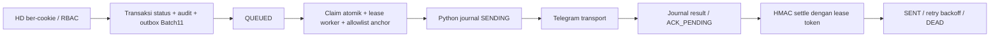

# Batch 12 — integrasi courier bot baru HD Work 2.0

Basis `f2ff31fe9439a5372c379a1903dcf5d0fc915164`, branch `chore/remove-cacti-hdwork2`.
Bot yang direncanakan: **@HDWorkOpsBot**, bot BotFather yang sama, bukan bot kedua.
Implementasi dan tes development saja. Tidak menghubungi Telegram, mengundang bot,
mengubah `.env`, PM2 aktif, Cloudflare, database aktif, bot/data lama atau Preview.
Semua aktivasi default nonaktif. Tidak ada framework/dependency baru.

## Audit dan reuse Batch 1–11

Dokumen pemisahan backend/API-only (Batch1–2), kontrak courier (3), persistent
store (4), parser/workflow (5/8/9), reader web (6), Windows/disposable guard (7),
cookie/RBAC (10), workflow/outbox/SSE (11) telah ditinjau. Keputusan baru-bot saja
Batch9 menggantikan rencana backfill bot lama pada dokumen Batch8 historis.

Reuse tabel `hd2_orders`, inbox, outbox, audit, tial_keys, users/sessions/modules,
live_events, state transitions web dan format pesan Batch11. Tidak membuat order
store, login, parser field atau sistem real-time kedua. Grammar parser hanya
diperluas agar `/command@HDWorkOpsBot` diterima secara case-insensitive ketika
username tersebut dikonfigurasi; mention bot lain/tanpa konfigurasi ditolak.
Teks sumber tetap utuh. Detail internal `/req` juga mengenali mention saat
memisahkan body. Tidak mengubah desain, route/filter/pagination frontend.

Lacuna sebelumnya: checkpoint Python masih memory-only; journal hanya untuk
rejection; belum ada composition root worker inbox; replay nonce hanya memory;
belum ada lease satu pemilik polling. Batch12 melengkapi lifecycle ini.
`courier-api-server.js`/MemoryStore dan gate rejection lama tetap fondasi historis,
**bukan startup integrasi baru**. Main Python terbaru tidak memanggil gate lama
atau mengirim rejection secara langsung. Input invalid dicatat lokal, tanpa
balasan Telegram yang tidak diminta. Template konfigurasi Batch9 saja tidak
memenuhi prasyarat startup Batch12.

## Proses dan aliran order

```mermaid
flowchart LR
  TG[Telegram Bot API: bot baru] --> PY[Python courier: satu polling owner]
  PY --> J[SQLite WAL journal privat + checkpoint]
  J -->|HMAC loopback| G[Node courier-b2c-server :3091]
  G --> I[MySQL hdwork2 inbox persisten]
  I --> W[Worker inbox Node, lifecycle eksplisit]
  W --> O[Parser existing + orders / audit / canonical]
  O --> L[Live events transaksional]
  L --> A[API-only :3090 SSE + REST ber-cookie]
  A --> R[React Batch11]
```



Tiga proses terpisah: API web, backend courier+worker inbox, Python courier.
Python tidak punya credential atau koneksi SQL. API web tidak mengimpor startup
courier, polling atau worker inbox. Restart/gagal Python tidak mematikan API;
gagal API web tidak menghentikan listener/inbox internal. Listener dan web hanya
bind `127.0.0.1`. Port internal tidak boleh ditunnelkan/dipublikasi.

Penerimaan HTTP dikonfirmasi **setelah commit inbox**, bukan setelah parsing
workflow selesai. Order/audit/canonical/invalidation kemudian dicatat dalam satu
transaksi worker existing. Inbox PENDING/DEAD adalah jejak persisten bila parsing
atau DB bermasalah; ACK bukan janji order sudah langsung terlihat di dashboard.

## Grup, command dan identitas

`ops/examples/batch12-groups.json` berisi placeholder numeric chat ID, bukan ID
yang dikarang atau konfigurasi grup aktif. Daftar command contoh adalah **usulan
untuk ditinjau**, bukan persetujuan akses grup nyata:

| Profil | Usulan allowlist | Modul izin hasil parsing |
|---|---|---|
| TIAL1 | order, req | TIAL, REQ |
| TIAL2 | order, req | TIAL, REQ |
| SOLVER1 | config_psb, mo | LOGIC_PSB, LOGIC_MO |

Setiap grup wajib punya array command eksplisit, tidak ada default semua command.
Profil SOLVER1 tetap tidak menerima order sesuai parser existing. Command config
yang tidak dikenal/kosong/duplikat, chat ID non-string/positif/placeholder, group
ganda, topic non-null atau mode selain non_topic ditolak sebelum koneksi.

Isi `COURIER_COMMAND_GROUPS_JSON` yang sama pada Node dan Python melalui konfigurasi
privat. Mapping modul logis mengikuti command; grouping visual TIAL/LOGIC tidak
menggantikan RBAC backend. Nama grup bukan kunci akses. Profile hanya memilih
validasi parser existing. Grup perlu diverifikasi nyata nanti dengan getChat;
`threadId=null` diterima karena konfigurasi eksplisit grup biasa yang direview,
bukan inferensi General. Python juga menolak metadata forum/topic. Tidak ada
`message_thread_id` yang dikirim untuk grup biasa.

Id chat/message/reply disimpan sebagai string, termasuk chat negatif. Telegram
update unik memakai `(bot_id, update_id)`, original anchor memakai
`(bot_id, chat_id, message_id)`. Retry transport tidak membuat order kedua.
Business duplicate tetap khusus `/order`: global full extracted SC/IN dalam
riwayat hdwork2 bot baru, lintas grup/tanggal, reservation HMAC existing. Canonical
pertama yang berhasil dicatat tidak diganti. Semua original duplicate disimpan;
tidak auto-reject/ubah canonical. Tiga command lain tidak dideduplikasi bisnis.
Tidak mengimpor hd_b2c, Sheets atau sejarah bot lama.

## Journal lokal, offline dan restart

`COURIER_JOURNAL_DIR/courier.sqlite3` memakai SQLite stdlib, WAL,
`synchronous=FULL`, cache sekitar4MiB, transaksi payload+checkpoint. Direktori
absolut di luar repo, privat; akun dan fingerprint token mengikat journal.
Token asli tidak disimpan. Pergantian token/bot dengan journal lama sengaja gagal;
jangan menghapus journal untuk mengatasi error, siapkan prosedur rotasi/pemulihan.

1. Telegram `getUpdates` memakai checkpoint yang telah di-commit.
2. Seluruh batch diproyeksikan/ditulis, baru offset tertinggi+1 di-commit.
3. Poll berikutnya boleh mengakui offset karena salinan lokal sudah durable.
4. Forward maksimal5 event/cycle, FIFO dengan backoff di head, HMAC nonce baru
   setiap HTTP attempt tetapi identitas event/payload tetap sama.
5. Hanya `ok=true` + receipt persisten yang membuat journal ACKED.
6. Timeout/ACK hilang mengulang event yang sama; Node mengembalikan receipt lama.

Retry journal tidak habis diam-diam: exponential2…300 detik. HTTP400/403/409/413
yang permanen menjadi QUARANTINED dengan payload privat dan kode alasan, bukan
delete atau penggantian identitas. Input tidak diizinkan menjadi IGNORED dengan
jejak lokal. Proyeksi rusak disimpan QUARANTINED; update >64KiB hanya digest/kode
ukuran, tidak seluruh raw. Envelope >60KiB tidak dikirim melampaui batas HTTP64KiB.
Update ID invalid/tidak berurutan atau conflict hash menghentikan cycle tanpa
memajukan checkpoint. Disk penuh/error transaksi juga tidak memajukan offset.
Jangan memutar offset/drop database/menyalin journal lintas bot sebagai recovery.

SQLite adalah salinan yang mengandung data order dan metadata lease internal;
ACL Windows, backup terenkripsi, kapasitas disk dan retensi privat wajib ditinjau.
Tidak ada purge otomatis. WAL/full sync tidak menjamin selamat dari kehilangan
disk/PC/power tanpa storage andal/UPS. File SQLite tidak masuk repo/log.

Saat backend unavailable, Python masih bisa menjournal hasil polling selama
lease yang sudah dikonfirmasi masih aman. Jika lease tidak dapat diperbarui,
**polling dan send berhenti**, backlog lokal tetap ada. Saat backend pulih,
renew/acquire lalu retry. Ini memilih satu polling owner daripada terus polling
tanpa kepastian kepemilikan. Telegram menyimpan update terbatas (umumnya24 jam);
outage panjang sebelum update dijournal tetap risiko eksternal. Tidak mengklaim
jaminan tanpa kehilangan pada outage tak terbatas. Monitoring backlog/lease/UPS
dibutuhkan sebelum aktivasi. Reset update ID setelah idle lama juga memerlukan
review checkpoint; jangan membuang backlog secara otomatis.

## Satu polling owner dan lifecycle

- OS advisory lock stdlib `fcntl`/Windows `msvcrt`, fingerprint token sebagai nama
  file; tidak menyimpan token. Semua instance pada PC harus memakai satu lokasi
  `COURIER_LOCK_DIR` yang disetujui. File lock **tidak di-unlink**, sehingga tidak
  ada bypass inode; proses mati melepas lock OS.
- Lease MySQL per bot_id (60 detik) melalui HMAC acquire/renew/release. UUID worker
  per proses dan lease token fence owner lama. Klien memakai deadline monotonic
  dari waktu sebelum request, renew sekitar10 detik, margin15 detik sebelum I/O.
- Backend memeriksa worker context yang termasuk body ter-sign, bukan header
  tak terlindungi. Claim memeriksa lease dengan shared lock dalam transaksi claim.
  Worker kedua ditolak409 sampai lease dilepas/kedaluwarsa.
- SIGINT/SIGTERM/SIGBREAK menghentikan cycle baru; tunggu I/O bounded10 detik,
  simpan hasil yang diketahui, best-effort release lease, tutup SQLite/OS lock.
  Node close menghentikan timer inbox, menunggu transaksi/HTTP, lalu menutup pool.
  Forced kill tidak dianggap graceful; journal, leases dan idempotency memulihkan.

Guard berlaku untuk pasangan layanan/alias bot yang dikonfigurasi konsisten.
Tidak dapat mencegah aplikasi lain di luar sistem memakai token yang sama atau
dua instalasi salah konfigurasi dengan backend/lock root berbeda. Jangan jalankan
polling via alat lain, cluster, salinan PC atau token alias berbeda. getMe/token
provenance dan satu pemilik polling wajib diverifikasi manual saat aktivasi.

## Outbox dan batas delivery



Pesan hanya berasal dari outbox server. Tidak ada endpoint enqueue publik.
Claim1 memakai locking existing; payload malformed/grup tidak diizinkan/anchor
tidak ada/command di luar allowlist menjadi DEAD BAD_REQUEST, tanpa send. Python
memeriksa allowlist/non_topic/reply lagi. Semua send adalah reply ke message order
asli dengan `allow_sending_without_reply=false`, tanpa edit/delete lama.

Format tetap sepenuhnya Batch11: kuning PICK/takeover/continue; DONE order dengan
ACTCOMP dan VALINS; DONE lainnya; alasan GAGAL; `❌ Duplikat Order`; reopen tanpa
pesan. Node web adalah otoritas workflow. `webOnly=true` menolak semua status reply
Telegram, meskipun global operations flag berubah; tidak ada actor Telegram yang
bisa melewati users/current-owner/RBAC. Sender→akun/status action belum dibuka.

Outbox existing: lease60 detik, lima attempts, exponential2…60 detik, retry_after
429 sampai300 detik, 400/403 permanen, DEAD setelah batas. Expired SENDING pulih
lewat claim berikutnya, bukan worker baru. Status order yang telah commit tetap
ada walaupun Telegram gagal. Jangan otomatis redrive SENT/DEAD.

Hasil send dicatat lokal **sebelum settle**. Restart/ACK HTTP hilang mengulang ACK
yang sama. Bila lease ACK lama stale, cached success dapat dipakai pada claim
berikutnya tanpa send ulang. Payload hash delivery yang berubah ditolak. Namun
timeout saat Telegram sudah menerima pesan sebelum respons, crash sebelum hasil
tersimpan, atau kehilangan journal tetap dapat menggandakan delivery. Telegram
sendMessage tidak menyediakan idempotency key: **exactly-once tidak dijamin**.
Cache mengurangi kasus duplikat yang diketahui, bukan bukti exactly-once mutlak.

## Kontrak HTTP internal

Prefix tetap `/internal/courier/v1`, POST JSON UTF8 <=64KiB, bind loopback,
rate limit existing300/menit, no CORS/browser Origin, generic error/no-store.
HMAC canonical v1 tetap:

```text
bot_id
timestamp_seconds
nonce_hex32
POST
exact_path
sha256(raw_body)
```

Headers X-Courier-Id/Time/Nonce/Signature, SHA256 HMAC, timestamp±60 detik,
timing-safe comparison. Nonce kini disimpan pada MySQL sebelum handler dan
bertahan saat listener restart, TTL120 detik; cleanup terbatas1000 expired row
saat request sah, maksimal kira-kira sekali/menit, bukan background purge.
DB nonce gagal =>503, tidak ada ACK palsu. Retry memakai nonce baru.

| Endpoint | Body tambahan / hasil |
|---|---|
| POST /worker/acquire | worker_id UUID → lease_token, lease_ms |
| POST /worker/renew | worker_id, lease_token → TTL |
| POST /worker/release | worker_id, lease_token |
| POST /events | Envelope v1 + worker:{id,lease_token} → receipt_id,duplicate |
| POST /outbox/claim | limit:1, worker → messages |
| POST /outbox/:id/result | lease_token delivery, result/sent ID/error_code/retry_after, worker |

Worker context dibuang dari normalized event sebelum digest inbox, sehingga
restart owner tidak mengubah idempotency payload. Idempotency event tidak memakai
nonce HTTP. Sesi pengguna web/JWT/CSRF tidak dipakai untuk endpoint internal;
HMAC bukan pengganti otorisasi web. Tidak menerima Authorization bot token.
Transport Python melarang redirect; internal loopback tidak melewati proxy.
Transport Telegram tetap HTTPS dengan verifikasi TLS/proxy environment normal.
Tidak mencatat URL Telegram, token, envelope, SC/IN, NIK atau exception mentah.

## Konfigurasi privat yang perlu diisi nanti

Template **nonaktif, tanpa secret**:
`ops/examples/batch12-courier.environment.json` dan `batch12-groups.json`.
Ini inventory, tidak otomatis dibaca/disalin menjadi .env.

| Variabel | Proses / kebutuhan |
|---|---|
| COURIER_BOT_ID | Alias stabil bot baru; sama pada Node/Python, jangan diubah saat retry |
| COURIER_BOT_USERNAME | HDWorkOpsBot, diverifikasi nanti; mention hanya ke username ini |
| COURIER_TELEGRAM_BOT_TOKEN | Hanya Python, secret bot baru yang sudah ada; jangan pakai token lama |
| COURIER_SERVICE_KEY | Node/Python, random>=32byte melalui kanal privat |
| COURIER_IDENTITY_KEY | Node saja; key canonical existing yang konsisten, berbeda dari service key |
| COURIER_COMMAND_GROUPS_JSON | Mapping numeric chat ID + commands eksplisit yang telah disetujui |
| COURIER_SERVER_URL / COURIER_PORT | Loopback HTTP :3091, berbeda dari port API/MySQL |
| COURIER_DB_HOST/PORT/NAME | Node internal; host127.0.0.1, NAME tepat hdwork2 |
| COURIER_DB_USER/PASSWORD | Akun courier baru, bukan root/akun API/staging; SQL credential tidak ke Python |
| COURIER_JOURNAL_DIR / LOCK_DIR | Absolut, di luar checkout, NTFS privat; lock root konsisten seluruh instance |
| COURIER_PYTHON_EXE | Python3.11+ absolut terpisah dari runtime bot lama |
| PM2_HOME / HDWORK2_LOG_DIR | Home bernama hdwork2-pm2 dan log absolut privat |

Flag per proses, semua absent/false secara default:

- Node membutuhkan COURIER_ENABLED, COURIER_INTEGRATION_ENABLED, COURIER_SCHEMA_READY,
  HDWORK2_OPERATIONS_ENABLED, HDWORK2_AUTH_V2, B2C_COMMAND_SCHEMA_READY true **setelah
  review/migrasi**, plus credential/mapping lengkap. Backend invalid gagal sebelum
  memuat driver. Readiness hanya SELECT LIMIT0, tidak migrate/provision.
- COURIER_RECEIVE_ENABLED mengizinkan POST event; COURIER_WORKER_ENABLED memulai
  consumer inbox; COURIER_OUTBOX_ENABLED mengizinkan claim/result. Independen,
  absent=false. Internal backend sendiri tidak mengirim Telegram.
- Python membutuhkan COURIER_ENABLED, COURIER_INTEGRATION_ENABLED,
  COURIER_ALLOW_NETWORK dan minimal satu COURIER_POLL_ENABLED/COURIER_SEND_ENABLED
  true. Poll off tidak memanggil getUpdates; send off tidak claim/send. Tanpa
  opt-in lengkap/config privat, CLI gagal sebelum network.
- Satu fork per backend, tidak cluster/instances>1. Tidak menyalakan flag produksi
  atau mengubah konfigurasi auth/operations yang aktif pada task ini.

Hak runtime Node minimal SELECT/INSERT/UPDATE pada tabel courier/workflow
existing yang digunakan; SELECT orders untuk anchor, INSERT audit/live_events,
DELETE hanya untuk expiry nonce, bukan DDL/GRANT/global. Akun API web terpisah.
Review grant per tabel bersama DBA; jangan menyalin credential bot/database lama.

## Windows: startup terpisah, belum dijalankan

Sesudah persetujuan konfigurasi, schema, backup, grup dan rehearsal native:

```powershell
# Terminal API web; konfigurasi API sendiri, tanpa token bot.
npm run start:api

# Terminal backend courier; environment privat Node sendiri, tanpa token bot.
.\ops\windows\start-courier-backend.ps1
# Ekuivalen: npm run start:courier

# Terminal Python; environment privat Python, tanpa SQL credential/identity key.
.\ops\windows\start-courier-bot.ps1
```

Script tidak memuat .env, tidak menyalakan flag, tidak membuat task/service,
tidak menjalankan pm2 save/restart all, dan mengembalikan exit code. Python path
hanya diubah pada proses foreground selama command; Ctrl+C mengakhiri loop.
`ops/windows/ecosystem.courier.config.cjs` adalah template PM2 dua proses baru
yang inert; API memakai template existing terpisah. flags/secrets hanya dari
environment privat yang benar untuk masing-masing proses. Jangan meluncurkan
kedua proses dari shell yang mengekspor semua secret ke semua child. PM2 daemon
environment/dump juga sensitif: gunakan home/akun/ACL khusus, jangan dump env ke
chat/log atau mengubah PM2 bot lama. Template tidak mengaktifkan daemon/autostart.

Batas contoh: Node courier224MiB/heap160MiB, Python160MiB, fork1, restart backoff,
max5 restart, kill_timeout90 detik. Ini guard resource, bukan hasil load RAM8GB.
Pool courier2 koneksi. Sediakan headroom MySQL/Windows/bot lama; ukur RSS dan disk
journal/log sebelum aktivasi. Batasi interpreter virtualenv terpisah; tidak ada
pip dependency baru pada Batch12.

Log rotation perlu disetujui/dipasang pada **PM2_HOME baru** nanti: misalnya
pm2-logrotate max_size10M, retain7, compress=true, interval harian. Modul tidak
diinstal/config sekarang. Jangan merotasi SQLite/WAL dengan copy/rename log biasa;
gunakan SQLite backup yang konsisten dan terenkripsi di lokasi privat. Grant ACL
hanya akun aplikasi/operator backup pada journal, lock, log, secret dan PM2 home.
POSIX chmod bukan bukti ACL Windows. Jangan gunakan folder share/OneDrive/Git.

PM2/Task Scheduler di Windows dapat force-kill child; SIGBREAK/graceful behavior
native belum diuji. Gunakan foreground Ctrl+C untuk rehearsal, lalu verifikasi
shutdown supervisor/Task Scheduler dan recovery journal sebelum autostart.
Task Scheduler/autostart tidak dibuat; jangan enable sebelum persetujuan.

## Migrasi 009 dan pemulihan

`009_hdwork2_courier_runtime.sql` baru; 004–008 tidak diubah. Menambah:

1. received_seq AUTO_INCREMENT unique pada inbox dan indeks bot/state/sequence
   untuk FIFO worker baru. Primary key/FK/unique original tetap. Default store
   lama memakai query semula, hanya new composition mengaktifkan orderedInbox.
2. hd2_courier_workers untuk single owner/fencing; tidak membuat tabel bot kedua.
3. hd2_courier_nonces untuk replay protection lintas restart.

Selesai rehearsal hanya pada MySQL8 disposable. Belum diterapkan pada database
aktif. AUTO_INCREMENT pada existing rows tidak merekonstruksi kronologi historis;
review inbox lama/pending sebelum aktivasi, jangan menafsirkannya sebagai urutan
Telegram global. Unique reservation canonical existing tidak di-reset. FIFO
berlaku berdasarkan urutan penerimaan tersimpan, bukan jaminan urutan wall-clock
lintas grup/transaksi. Backoff head menahan pending berikutnya sampai berhasil/
DEAD; DEAD dan quarantine perlu review, tidak ada redrive otomatis.

Backup konsisten hdwork2 mencakup inbox/outbox/orders/audit/keys/users/sessions/
live_events dan dua tabel baru, serta backup SQLite dengan API backup SQLite.
Uji restore pada cleanroom. Jangan restore keys secara terpisah atau hilangkan
journal success cache; dapat mengubah canonical/mengulang delivery. Rehearsal
009 memverifikasi row inbox existing tetap ada setelah ALTER.

DDL implicit commit per statement; ALTER AUTO_INCREMENT/index dapat rebuild
table/metadata lock dan membutuhkan disk/maintenance window. Tidak idempotent:
jangan rerun dengan --force pada schema parsial. Rollback aplikasi: hentikan
hanya komponen baru secara terkontrol, matikan flag yang disetujui, biarkan
schema/journal/history additive. Jangan DROP/truncate/requeue massal. Restore
snapshot memerlukan RPO/approval: data setelah backup bisa hilang dan Telegram
yang sudah terkirim tidak bisa dibatalkan oleh rollback SQL. Tidak ada backup
produksi/restore nyata yang dilakukan dalam task ini.

## Pengujian dan batas bukti

Semua Telegram memakai FakeTelegram/mock transport, bukan api.telegram.org.
Backend unit memakai mock, native rehearsal memakai instance MySQL8.0.46
disposable/namespace hdwork2_test_<16hex>, akun scoped, localhost port non3306,
RAM1GiB/CPU1 dan datadir sementara. Tidak memakai schema aktif hdwork2/hd_b2c.

Perintah aman:

```bash
PYTHONPATH=courier_bot python3 -m unittest discover -s courier_bot/tests
node --test --test-isolation=none tests/*.test.js
node --test --test-isolation=none frontend/tests/*.test.ts
npm --prefix frontend run lint
npm --prefix frontend run build
```

Native opt-in hanya di disposable **kosong**, memakai guard/grants Batch7/9.
Isi environment HDWORK2_MYSQL_TEST_* privat, enable DISPOSABLE_ONLY, host127.0.0.1,
port non3306, nama/akun disposable yang diizinkan, password privat; opsional
HDWORK2_TEST_PYTHON executable untuk harness Windows. Jangan taruh secret di args.

```powershell
node .\tests\integration\mysql-courier-integration.cjs --run-courier-disposable
```

Harness menolak schema non-disposable/root/global grants/non-loopback/DB berisi,
membuang directive USE hdwork2 secara terjaga sebelum DDL, tidak membuat schema
aktif atau bot. Python helper hanya mengizinkan server loopback ephemeral dan
journal OS temp. Setelah tes, buang hanya container/test credentials milik
rehearsal. Regresi native Batch11 memakai instance disposable fresh terpisah.

| Tes wajib | Bukti |
|---|---|
| 1–4 parser, modul, unknown chat/command | Node/Python policy tests; mention/case/spasi/multiline; native5 order4command |
| 5–8 identitas, web, duplikat cross group/day | Native Python→HMAC→MySQL→cookie dashboard REST + source IDs/canonical |
| 9–10 backend/MySQL offline | Python503/backoff/journal; native injected connection failure503 lalu retry/replay receipt sama |
| 11–14 restart, redelivery, request/ACK hilang | SQLite restart + FIFO; native Python proses baru; HTTP ACK event/send hilang |
| 15–17 HMAC/time/replay | Signed HTTP mock/loopback; durable nonce duplicate ditolak instance RuntimeStore baru |
| 18–20 claim/ACK/retry/dead-letter | Existing unit + native competing claims, TTL expiry/stale ACK, lima retry DEAD, unauthorized payload DEAD |
| 21–25 seluruh format/reopen tanpa pesan | Policy exact text Batch11 + native web actions/outbox readback/FakeTelegram digest |
| 26 original reply | Native payload digest sama persis, Python reply guard dan TelegramClient mock reply_parameters |
| 27 dua worker | OS lock; native acquire race/fence/expiry; claim lock tidak menggandakan delivery |
| 28 graceful | Python stop/lease release, Node in-flight worker close/one pool close; Windows native belum diuji |
| 29 SSE | Native SSE cookie setelah inbox order commit; event tanpa payload sensitif; browser page2 existing |
| 30 regresi | Seluruh Node/Python/frontend unit, build/lint, browser workflow/Preview; native Batch11 terpisah |

## Risiko, keputusan aktivasi dan Batch13

- Belum verifikasi getMe/getChat, token provenance, membership, privacy mode,
  send permission atau chat ID nyata. Bot belum diundang ke grup lewat task ini.
  Jangan menonaktifkan privacy mode global tanpa menilai informasi yang terlihat
  bot; empat slash command dengan mention memadai untuk rehearsal awal.
- Outage lebih lama dari retensi Telegram, kehilangan disk, crash ambigu send,
  restore journal/DB yang tidak konsisten dan aplikasi polling unmanaged adalah
  batas jaminan. Exactly-once dan zero-loss absolut tidak diklaim.
- Maksimal300 request/menit internal tetap. Lima forward/cycle+claim/ACK/renew
  menghemat request; lonjakan bisa menambah journal backlog/429. Tidak menaikkan
  rate limit. Queue/disk/RSS/lease age dan DEAD/quarantine perlu monitoring.
- Nonce expiry indexed dan bounded, inbox ordered indexed. Belum ada load puluhan
  ribu pesan, pengukuran kantor RAM8GB, native Windows ACL/lock/supervisor,
  backup-restore produksi atau HTTPS/Tunnel. Frontend tidak menambah dependency/
  bundle. Tetap pagination/SSE Batch11, tidak membuat polling30 detik kedua.

Urutan tahap berikutnya (semuanya **memerlukan persetujuan aktivasi terpisah**):
1. Review diff, izin grup/command, identitas @HDWorkOpsBot dan key canonical; isi
   secret di kanal privat khusus proses, bukan Git/frontend/chat.
2. Preflight Windows/resource/NTP/ACL/port, rehearsal disposable Windows, backup
   dan uji restore, review row backlog dan partial schema007–009 bersama DBA.
3. Setelah disetujui, migrasi009 manual pada hdwork2, akun SQL per tabel dan
   startup API-only existing. Tidak menyentuh database/bot lama.
4. Verifikasi getMe serta grup biasa/numeric IDs/permissions dengan bot baru;
   undang hanya grup uji setelah diizinkan. Review flag ingress/worker/poll secara
   bertahap; mulai dengan send/outbox tetap false.
5. Uji satu order sintetis end-to-end, duplicate, offline/restart, RBAC/ownership,
   SSE dan backlog. Lalu persetujuan outbox/send, uji original reply dan audit.
6. Baru rencanakan PM2/Task Scheduler/autostart, log rotation, monitoring/alert,
   load limits dan Tunnel/Cloudflare sebagai pekerjaan terpisah. Jangan mengubah
   bot lama/produksi secara otomatis sebagai fallback/rollback.

## Hasil akhir development

- Node: 152/152 tes lulus (`--test-isolation=none`, termasuk regression Batch1–11).
- Python: 31/31 tes lulus, stdlib/unittest, seluruh Telegram mock.
- Frontend unit: 56/56 lulus; dua suite browser workflow dan offline draft lulus,
  termasuk desktop/mobile, Preview, pagination page2/SSE dan session recovery.
  Suite arsip browser lain tidak semuanya dijalankan ulang pada Batch12.
- Build berhasil, aset frontend (nama/hash/ukuran/gzip) **identik** dengan build
  Batch11. Tidak ada file frontend atau dependency baru. Lint exit0 dengan29
  warning existing; chunk LegacyRoutes sekitar509,87kB masih memberi warning.
- Native MySQL8.0.46: 004–009 lulus pada schema fresh, termasuk preservasi fixture
  inbox existing saat ALTER009. Roundtrip5 order awal dari empat command,
  canonical lintas grup/hari,13 reply FakeTelegram, restart/ACK hilang, SSE dan
  SQL failure/retry/replay; total8 order setelah pengujian recovery tambahan.
  Claim race, lease expiry, lima retry DEAD dan blok payload tak diizinkan lulus.
  EXPLAIN head queue memilih `courier_inbox_ordered`; bukan load test skala besar.
- Native regression Batch11 pada schema fresh lain lulus: race PICK/takeover,
  ownership/RBAC, reopen/duplikat/rekap, export550 row/rollover/formula/cancel.
  Export sekitar105ms pada sampel cloud ini bukan SLA Windows8GB.
- Warning Promise-like Express dari VM test lintas realm muncul dalam harness
  native; bukan crash/test gagal atau bukti warning runtime produksi.
- `npm audit --omit=dev`: 0 advisory. `git diff --check` bersih.
- Resource disposable/test server dan credential temporer dibersihkan setelah
  verifikasi. Tidak ada token/password/data pelanggan asli di commit.

## Manifest file

35 file: 13 existing diubah dan 22 baru.

Existing:

- `courier_bot/README.md`
- `courier_bot/courier/__main__.py`
- `courier_bot/courier/clients.py`
- `courier_bot/courier/commands.py`
- `courier_bot/courier/http.py`
- `package.json`
- `src/b2c-workflow/command-storage.js`
- `src/b2c-workflow/commands.js`
- `src/b2c-workflow/config.js`
- `src/b2c-workflow/workflow.js`
- `src/courier/auth.js`
- `src/courier/mysql-store.js`
- `src/operations/read.js`

Baru:

- `courier-b2c-server.js`
- `courier_bot/courier/durable_runner.py`
- `courier_bot/courier/groups.py`
- `courier_bot/courier/journal.py`
- `courier_bot/courier/lock.py`
- `courier_bot/courier/runtime_config.py`
- `courier_bot/tests/test_durable.py`
- `database/manual/009_hdwork2_courier_runtime.sql`
- `docs/batch12-telegram-integration.md`
- `ops/examples/batch12-courier.environment.json`
- `ops/examples/batch12-groups.json`
- `ops/windows/ecosystem.courier.config.cjs`
- `ops/windows/start-courier-backend.ps1`
- `ops/windows/start-courier-bot.ps1`
- `src/courier/groups.js`
- `src/courier/inbox-worker.js`
- `src/courier/integration-app.js`
- `src/courier/integration-config.js`
- `src/courier/runtime-store.js`
- `tests/courier-integration.test.js`
- `tests/helpers/courier-roundtrip.py`
- `tests/integration/mysql-courier-integration.cjs`
